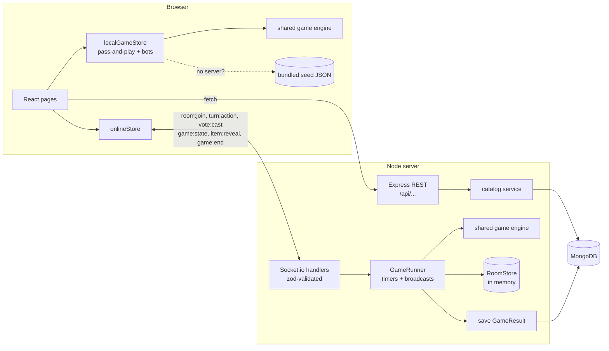

# 💸 Budget Draft

Who can build the better team with **$20**?

Items from a category (footballers, rappers, fast food…) are revealed one at a time.
Players take turns to **BUY** or **PASS**. Only one player gets each item, and you have
to fill every slot without running out of money. The highest-rated team wins, and
everyone votes for the team they like best.

Built with the MERN stack and TypeScript everywhere: React + Vite, Express, MongoDB +
Mongoose and Socket.io.

## Modes

| Mode | How it works | Needs the server? |
| --- | --- | --- |
| 📱 Pass & Play | 2–4 players on one device. A "pass the device" screen between turns. | No (uses bundled data) |
| 🌐 Online Room | Create a room, share the 6-letter code or link. 15s turn timer. | Yes |
| 🤖 Solo vs Bots | You against 1–3 bots that look for good value. | No |

## Setup

You need **Node.js 22.9+** and a **MongoDB** database (local, Docker or Atlas).

```bash
# 1. Install everything (one install for all three packages)
npm install

# 2. Create your .env from the example and fill it in
cp .env.example .env

# 3. (Optional) start MongoDB with Docker
docker compose up -d

# 4. Load the 10 categories (467 items) into MongoDB
npm run seed

# 5. Start the API (port 4000) and the web app (port 5173)
npm run dev
```

Open http://localhost:5173.

Pass-and-play and bot mode work without the server: the app bundles the seed data and
uses it whenever the API can't be reached.

### Environment variables

All variables live in one `.env` file at the repo root. The server checks them with zod
at startup and stops with a clear message if one is missing.

| Variable | Used by | Example | What it's for |
| --- | --- | --- | --- |
| `MONGO_URI` | server | `mongodb://localhost:27017/budget-draft` | Database connection |
| `PORT` | server | `4000` | API + Socket.io port |
| `ADMIN_PASSWORD` | server | at least 8 characters | Password for `/admin` |
| `CLIENT_URL` | server | `http://localhost:5173` | Allowed origin for CORS and sockets |
| `VITE_SERVER_URL` | client | `http://localhost:4000` | Where the web app finds the API |

### Scripts

Run these from the repo root.

| Command | What it does |
| --- | --- |
| `npm run dev` | Server (auto-restarts on change) + client (hot reload) together |
| `npm run seed` | Clears categories and items, then reloads them from `server/seed/*.json` |
| `npm test` | Every Vitest suite (shared, server, client). Includes a typecheck of `shared`. |
| `npm run typecheck` | Strict TypeScript check of all three packages |
| `npm run build` | Production build of the web app into `client/dist` |
| `npm start` | Start the server without file watching |

Tests that need a database start a throwaway in-memory MongoDB, so `npm test` doesn't
need your real database.

## Architecture

```
budget-draft/
├── shared/   Types, zod schemas and the pure game engine. Used by BOTH client and server.
├── server/   Express REST API, Socket.io rooms, Mongoose models, seed data (server/seed/*.json)
└── client/   React + Vite + Tailwind web app, Zustand stores
```



**One game engine, three modes.** All the rules (budget check, turn order, scoring, the
bot) are pure functions in `shared/src/game/`. They take a state and return a new state,
with no network, database or timers. The browser runs them for pass-and-play and bot
games, and the server runs exactly the same code for online rooms.

**The server is in charge online.** For online games the real `GameState` only exists
on the server. Clients send intentions ("BUY", "PASS", a vote), the server checks them
with zod and the engine, then sends everyone the new state. Clients can't skip the
budget rule or act out of turn: the acting player's id comes from their socket, never
from the message.

**The item pool stays secret.** The full state includes `itemPool` (the shuffled items
still to come). Clients only ever get `PublicGameState`, which has
`itemPool?: never` and just an `itemsRemaining` count. Because every server→client
socket event is typed with `PublicGameState`, sending the full state is a compile error.
A type test (`shared/src/__typetests__`) checks that this protection holds.

### REST API

| Method & path | Description |
| --- | --- |
| `GET /api/categories` | All categories with item counts |
| `GET /api/categories/:slug/items` | Items in a category |
| `POST /api/rooms` | Create a room → `{ code }` |
| `GET /api/rooms/:code` | Room info (phase, player count, joinable) |
| `GET /api/leaderboard` | Wins, games played, best score (online games only) |
| `POST /api/results` | Store a finished local/bot game (never ranked) |
| `/api/admin/...` | Category and item CRUD, needs the `x-admin-password` header |

### Socket events

| Client → server | Server → client |
| --- | --- |
| `room:join` (code, name, stored playerId) | `room:update` (lobby + game snapshot) |
| `room:leave` | `item:reveal` (new item + state) |
| `room:settings` (host only) | `game:state` (after every action) |
| `game:start` (host only) | `game:end` (final state + results) |
| `turn:action` (buy/pass + round number) | |
| `vote:cast` | |

Every request gets an acknowledgement: `{ ok: true, data }` or `{ ok: false, error }`.

### Data models

- **Category**: `slug` (unique), `name`, `emoji`, `description`
- **Item**: `name`, `categorySlug`, `price` (1–10), `rating` (1–100), `tag`, optional `emoji`.
  Unique per (category, name).
- **GameResult**: mode, category, settings, players with a *snapshot* of their team and
  scores, `statsWinnerIds`, `voteWinnerIds`, and `countsForLeaderboard` (true only for
  online games).

No images or logos anywhere: items are names and text, shown with an emoji or a
generated initials avatar.

## How the game works

### The budget rule

Every empty slot will need an item eventually, and the cheapest real item costs $1.
So when you buy something, **you must keep at least $1 for each of your other empty slots**.

> Most you can spend right now = budget − (empty slots − 1)

| Situation | Can spend up to |
| --- | --- |
| $20, 5 empty slots | $20 − 4 = **$16** |
| $5, 3 empty slots | $5 − 2 = **$3** (a $4 item is blocked) |
| $3, 1 empty slot (the last one) | **$3**: spend it all |

The server enforces this (`getBuyBlockReason` in `shared/src/game/rules.ts`), and the
UI uses the same function to grey out BUY and explain why.

### Turn order

1. An item is revealed. Players act in seat order, **starting from a different player
   each round** (the first seat moves one place to the right every item).
2. Players with a full team are skipped. Players who can't afford the item under the
   budget rule are skipped too, and get a "can't afford" note. Budgets only change when
   someone buys, and a buy ends the round, so asking them would be pointless.
3. Each player chooses **BUY** or **PASS**. The first BUY takes the item and ends the round.
   Online, each player gets 15 seconds; running out of time counts as a pass.
4. If everyone passes, the item is discarded. If nobody can afford an item at all, it is
   discarded straight away and the next one comes up.
5. The draft ends when every team is full. If the items run out first, the empty slots get
   **$0 "Bench Player" items rated 10**.

### Scoring and voting

- **Team score** = sum of ratings + **1 point per $1 left over** (small on purpose).
- **Stats winner** = highest team score. Ties share the win.
- **Voting** only happens with **3+ human players** (with 2 you'd just vote for each
  other). Nobody can vote for themselves. Online there is a 30-second timer; in
  pass-and-play people vote one at a time with no timer. The results show the stats
  winner and the vote winner separately (or "tie").

### Seed data

Prices roughly follow ratings (90+ costs $8–10, under 55 costs $1), but every category has
**2–3 bargains** (much cheaper than their rating suggests) and **2–3 overpriced** items.
Spotting them is the skill. A test (`server/src/seed/__tests__/seedFiles.test.ts`) checks
every file: 40+ items, valid prices and ratings, tags, unique names and the bargain/overpriced
counts. Ratings are a playful opinion for the game, not a real-world ranking.

## Known limits

- **Live rooms are in memory.** Online rooms live in the server process (`RoomStore`).
  **If the server restarts, every room in progress is lost**, and players see "No room
  with that code. It may have expired." Finished games are already saved in MongoDB.
  Running several server instances would need shared room storage (for example Redis)
  and the Socket.io Redis adapter.
- **Empty rooms are deleted** after 10 minutes with nobody connected.
- **No accounts.** A player id stored in the browser is what lets you reconnect to your
  seat. Clearing site data or switching device means joining as a new player. The
  leaderboard groups players by name (case-insensitive), so two people using the same
  name share an entry.
- **Leaderboard = online games only.** In local and bot games one person controls every
  name, so those results are stored (`countsForLeaderboard: false`) but never ranked.
- **Admin is a single shared password**, sent as a header over HTTPS in production. It's
  compared in constant time, but there are no user accounts, roles or rate limiting.
- **Timers use the server's clock.** The countdown on each phone is approximate (it
  never shows more than the full turn length). The server decides when time is up.
