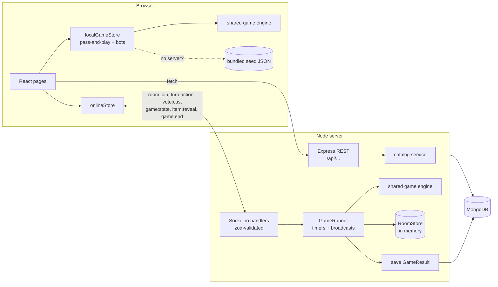

# 💸 Budget Draft

Who can build the better team with **$20**?

Items from a category (footballers, rappers, fast food…) are revealed one at a time.
Players take turns to **BUY** or **PASS**. Only one player gets each item, and you have
to fill every slot without running out of money. The highest-rated team wins, and
everyone votes for the team they like best.

Built with the MERN stack and TypeScript everywhere: React + Vite, Express, MongoDB +
Mongoose and Socket.io.

## Modes

| Mode | How it works | Needs the server? |
| --- | --- | --- |
| 📱 Pass & Play | 2–4 players on one device. A "pass the device" screen between turns. | No (uses bundled data) |
| 🌐 Online Room | Create a room, share the 6-letter code or link. 15s turn timer. The host can **Rematch** from the results (same players, new shuffle), or create the room with **their own list** of 20–150 items (`name, price, rating, tag` per line, pasted from anywhere, kept for that room only). | Yes |
| 🤖 Solo vs Bots | You against 1–3 bots (easy, medium or hard). | No |
| 📅 Daily Challenge | Same category and item order for everyone today (UTC), against one hard bot. One try per day. Share your score as "Budget Draft #12 — 412 pts 🟩🟩🟨🟩⬜". | To post a score |

Every mode can be played in either **draft style**, with any mix of the **extras**:

| Draft style | |
| --- | --- |
| Classic | BUY or PASS at the listed price. The first BUY wins the item. |
| Auction | Bid against each other, starting at $1. The highest bid wins. Online: 7s per bid. |

| Extra (all off by default) | |
| --- | --- |
| Balanced team | +15 points for a team with every role the category defines (football, cricket). |
| Mystery items | About 1 in 6 items hide their rating until the draft ends. |
| Power-ups | Veto, Discount (Classic only) and Peek, once each per game. |

The **Chaos** preset switches every extra on.

Also everywhere:

- **How to play**: 4 short cards on your first visit; the **?** in the header opens them again.
- **Sound effects** for buy, pass, the last 5 seconds of a timer, and the results. They're
  generated with the Web Audio API (no audio files). The speaker button mutes them, and
  that choice is remembered in localStorage.
- **A dark editorial look**: midnight black (`#08090B`), warm white (`#F5F3EF`) and golden
  yellow (`#FFC900`), with an upright Instrument Serif for headlines (self-hosted with
  `@fontsource`), DM Sans for body text, thin hairlines and small uppercase labels. Gold is the
  only accent: buttons, prices, the active player and urgency. The palette is six Tailwind theme
  tokens in `client/src/index.css` (mirrored in `lib/palette.ts`, where a test checks WCAG AA
  contrast for every pairing). There is no warning colour, so urgency is a pulsing gold icon
  plus motion. UI icons are thin lucide line icons; the only full-colour emoji are the
  reactions (and category emoji, which are content). Open `/style-guide` to see every colour,
  type size and component.
- **Emoji reactions** in online rooms: 👏 😂 😱 🔥 💸 float up the board for everyone, one per
  player per second.

## Setup

You need **Node.js 22.9+** and a **MongoDB** database (local, Docker or Atlas).

```bash
# 1. Install everything (one install for all three packages)
npm install

# 2. Create your .env from the example and fill it in
cp .env.example .env

# 3. (Optional) start MongoDB with Docker
docker compose up -d

# 4. Load the 10 categories (483 items) into MongoDB
npm run seed

# 5. Start the API (port 4000) and the web app (port 5173)
npm run dev
```

Open http://localhost:5173.

Pass-and-play and bot mode work without the server: the app bundles the seed data and
uses it whenever the API can't be reached.

### Environment variables

All variables live in one `.env` file at the repo root. The server checks them with zod
at startup and stops with a clear message if one is missing.

| Variable | Used by | Example | What it's for |
| --- | --- | --- | --- |
| `MONGO_URI` | server | `mongodb://localhost:27017/budget-draft` | Database connection |
| `PORT` | server | `4000` | API + Socket.io port |
| `ADMIN_PASSWORD` | server | at least 8 characters | Password for `/admin` |
| `CLIENT_URL` | server | `http://localhost:5173` | Allowed origin for CORS and sockets |
| `VITE_SERVER_URL` | client | `http://localhost:4000` | Where the web app finds the API |

### Scripts

Run these from the repo root.

| Command | What it does |
| --- | --- |
| `npm run dev` | Server (auto-restarts on change) + client (hot reload) together |
| `npm run seed` | Clears categories and items, then reloads them from `server/seed/*.json` |
| `npm test` | Every Vitest suite (shared, server, client). Includes a typecheck of `shared`. |
| `npm run typecheck` | Strict TypeScript check of all three packages |
| `npm run build` | Production build of the web app into `client/dist` |
| `npm start` | Start the server without file watching |

Tests that need a database start a throwaway in-memory MongoDB, so `npm test` doesn't
need your real database.

## Architecture

```
budget-draft/
├── shared/   Types, zod schemas and the pure game engine. Used by BOTH client and server.
├── server/   Express REST API, Socket.io rooms, Mongoose models, seed data (server/seed/*.json)
└── client/   React + Vite + Tailwind web app, Zustand stores
```



**One game engine, three modes.** All the rules (budget check, turn order, scoring, the
bot) are pure functions in `shared/src/game/`. They take a state and return a new state,
with no network, database or timers. The browser runs them for pass-and-play and bot
games, and the server runs exactly the same code for online rooms.

**The server is in charge online.** For online games the real `GameState` only exists
on the server. Clients send intentions ("BUY", "PASS", a vote), the server checks them
with zod and the engine, then sends everyone the new state. Clients can't skip the
budget rule or act out of turn: the acting player's id comes from their socket, never
from the message.

**The item pool stays secret.** The full state includes `itemPool` (the shuffled items
still to come). Clients only ever get `PublicGameState`, which has
`itemPool?: never` and just an `itemsRemaining` count. Because every server→client
socket event is typed with `PublicGameState`, sending the full state is a compile error.
A type test (`shared/src/__typetests__`) checks that this protection holds.

### REST API

| Method & path | Description |
| --- | --- |
| `GET /api/categories` | All categories with item counts |
| `GET /api/categories/:slug/items` | Items in a category |
| `POST /api/rooms` | Create a room → `{ code }`. Optional `customItems` (20–150 `{ name, price, rating, tag }`) plays the host's own list |
| `GET /api/rooms/:code` | Room info (phase, player count, joinable) |
| `GET /api/leaderboard` | Wins, games played, best score (online games only; best score from Classic games with no extras) |
| `POST /api/results` | Store a finished local/bot game (never ranked) |
| `POST /api/daily` | Submit a Daily Challenge: `{ dateKey, playerName, moves }`. The server replays the moves to get the score → `{ total, rank, players }` |
| `GET /api/daily/leaderboard?date=YYYY-MM-DD` | Top 20 for one day's daily (default today, UTC) |
| `/api/admin/...` | Category and item CRUD, needs the `x-admin-password` header |

### Socket events

| Client → server | Server → client |
| --- | --- |
| `room:join` (code, name, stored playerId) | `room:update` (lobby + game snapshot) |
| `room:leave` | `item:reveal` (new item + state) |
| `room:settings` (host only) | `game:state` (after every action) |
| `game:start` (host only) | `game:end` (final state + results) |
| `game:rematch` (host only, after the game ends: same players, new shuffle) | |
| `turn:action` (buy/pass/bid/veto/discount + round number) | |
| `turn:peek` (Peek: the next item comes back in the ack, to you only) | |
| `vote:cast` | `reaction` (who sent which emoji) |
| `reaction:send` (one of 👏 😂 😱 🔥 💸, max 1 per second per player) | |

Every request gets an acknowledgement: `{ ok: true, data }` or `{ ok: false, error }`.

### Data models

- **Category**: `slug` (unique), `name`, `emoji`, `description`
- **Item**: `name`, `categorySlug`, `price` (1–10), `rating` (1–100), `tag`, optional `emoji`.
  Unique per (category, name).
- **Category** also has `roles` (empty for most categories). In a category with roles, every
  item's tag must be one of them.
- **GameResult**: mode, category, settings, `draftStyle`, `preset` (classic / custom /
  chaos), players with a *snapshot* of their team (with the price actually paid) and
  scores, `statsWinnerIds`, `voteWinnerIds`, and `countsForLeaderboard` (true only for
  online games). Results saved before `draftStyle`/`preset` existed are read as Classic.
- **DailyResult**: `dateKey`, `playerName`, `total` and `botTotal` (both worked out by the
  server), and the `moves` (so a score can be checked again). Unique per (day, lower-case name).

No images or logos anywhere: items are names and text, shown with an emoji or a
generated initials avatar.

## How the game works

### The budget rule

Every empty slot will need an item eventually, and the cheapest real item costs $1.
So when you buy something, **you must keep at least $1 for each of your other empty slots**.

> Most you can spend right now = budget − (empty slots − 1)

| Situation | Can spend up to |
| --- | --- |
| $20, 5 empty slots | $20 − 4 = **$16** |
| $5, 3 empty slots | $5 − 2 = **$3** (a $4 item is blocked) |
| $3, 1 empty slot (the last one) | **$3**: spend it all |

The server enforces this (`getBuyBlockReason` in `shared/src/game/rules.ts`), and the
UI uses the same function to grey out BUY and explain why.

### Turn order

1. An item is revealed. Players act in seat order, **starting from a different player
   each round** (the first seat moves one place to the right every item).
2. Players with a full team are skipped. Players who can't afford the item under the
   budget rule are skipped too, and get a "can't afford" note. Budgets only change when
   someone buys, and a buy ends the round, so asking them would be pointless.
3. Each player chooses **BUY** or **PASS**. The first BUY takes the item and ends the round.
   Online, each player gets 15 seconds; running out of time counts as a pass.
4. If everyone passes, the item is discarded. If nobody can afford an item at all, it is
   discarded straight away and the next one comes up.
5. The draft ends when every team is full. If the items run out first, the empty slots get
   **$0 "Bench Player" items rated 10**.

### Auction

1. Each item opens with no bids. The first bid can be $1; every bid after that must be at
   least $1 more than the high bid, and it must follow the budget rule.
2. Bidding goes round the table. A bid sends you to the back of the queue so everyone else
   answers first. **PASS** means you're out for this item.
3. When everyone except the high bidder has passed, the high bidder gets the item **at their
   bid**. If everyone passes before anyone bids, the item is discarded.
4. Players who can't afford the next bid are skipped automatically. The budget rule is what
   stops a bidding war: nobody can bid more than they can spend.
5. Quick-bid buttons raise the high bid by +$1, +$2 or +$5 and grey out when the budget
   rule blocks them.

### Extras

- **Balanced team**: a category can list roles (football: Goalkeeper, Defender, Midfielder,
  Forward; cricket: Batter, Bowler, All-rounder, Wicketkeeper). An item's tag is its role.
  A team with at least one of every role gets **+15**. It needs at least as many slots as
  roles, and bench items don't count. The board shows which roles each team still needs.
- **Mystery items**: about 1 in 6 items show only price and tag. The rating is revealed
  when the draft ends. The server never sends a hidden rating: public items have
  `rating: number | null`, so the compiler points at every place the UI shows one.
  Bots play fair and guess a mystery item's rating from its price.
- **Power-ups**, each usable once per game, on your own turn:
  - **Veto**: discard the current item, as long as nobody has bid on it yet.
  - **Discount** (Classic only): buy the current item for $2 less (minimum $1). A player
    who could only afford the item with their Discount is still asked.
  - **Peek**: see the next item. Online it comes back only to you; everyone else just sees
    that you peeked. On a shared device it's shown only while it's still your turn.

### Bots

Bots play fair. They never see the full game state, only what a player sees plus the list of
items not revealed yet, **sorted by rating**. A careful human could work that list out
from the category; the secret part, the order of the pile, stays hidden. Bots guess a
mystery item's rating from its price.

| Level | How it plays |
| --- | --- |
| Easy | Takes an item when its rating per dollar is at least 11. Never pays for stars. |
| Medium | Compares the item with the average rating still to come. Below average only as a bargain, above average up to its per-slot budget, and a fair price plus $2 for a star. |
| Hard | Plans its budget across all its empty slots: is "this item now + the best plan for my other slots" better than "the best plan without it"? The plan is a small knapsack over the items still to come, thinned out for the other players. The same sum gives its highest auction bid. With Balanced team on, it values roles it still needs. |

`shared/src/game/__tests__/botDifficulty.test.ts` plays 200 seeded games per check on the
real seed categories, swapping seats each game. Hard must beat easy in at least 70% of
games (it wins about 98% in Classic and Auction), and easy vs easy must stay between 40% and
60% so neither seat is favoured.

### Scoring and voting

- **Team score** = sum of ratings + **1 point per $1 left over** (small on purpose)
  + **15** for a balanced team (when that extra is on).
- **Stats winner** = highest team score. Ties share the win.
- **Voting** only happens with **3+ human players** (with 2 you'd just vote for each
  other). Nobody can vote for themselves. Online there is a 30-second timer; in
  pass-and-play people vote one at a time with no timer. The results show the stats
  winner and the vote winner separately (or "tie").

### Seed data

Prices roughly follow ratings (90+ costs $8–10, under 55 costs $1), but every category has
**2–3 bargains** (much cheaper than their rating suggests) and **2–3 overpriced** items.
Spotting them is the skill. A test (`server/src/seed/__tests__/seedFiles.test.ts`) checks
every file: 40+ items, valid prices and ratings, tags, unique names and the bargain/overpriced
counts. Ratings are a playful opinion for the game, not a real-world ranking.

## Known limits

- **Live rooms are in memory.** Online rooms live in the server process (`RoomStore`).
  **If the server restarts, every room in progress is lost**, and players see "No room
  with that code. It may have expired." Finished games are already saved in MongoDB.
  Running several server instances would need shared room storage (for example Redis)
  and the Socket.io Redis adapter.
- **Empty rooms are deleted** after 10 minutes with nobody connected.
- **No accounts.** A player id stored in the browser is what lets you reconnect to your
  seat. Clearing site data or switching device means joining as a new player. The
  leaderboard groups players by name (case-insensitive), so two people using the same
  name share an entry.
- **The daily's items can be found in dev tools.** The day's game is built in the browser
  from the date (it's the seed), so a curious player can work out the item order before
  playing. The server replays every submitted move list, so scores can't be faked, but a
  player who looked ahead can play perfectly. Fine for a casual game.
- **One daily attempt per device is a localStorage flag.** Clearing site data gives
  another try. The server allows one score per name per day; a new name gets around that.
- **Best score only counts Classic games with no extras.** Auctions, power-ups and the
  balanced bonus all change what a score means. Wins count in every mode.
- **Custom lists aren't ranked.** A host could paste a list of cheap 100-rated items, so
  those games are saved with `countsForLeaderboard: false`. The list itself lives only in
  the room's memory.
- **Leaderboard = online games only.** In local and bot games one person controls every
  name, so those results are stored (`countsForLeaderboard: false`) but never ranked.
- **Admin is a single shared password**, sent as a header over HTTPS in production. It's
  compared in constant time, but there are no user accounts, roles or rate limiting.
- **Timers use the server's clock.** The countdown on each phone is approximate (it
  never shows more than the full turn length). The server decides when time is up.
