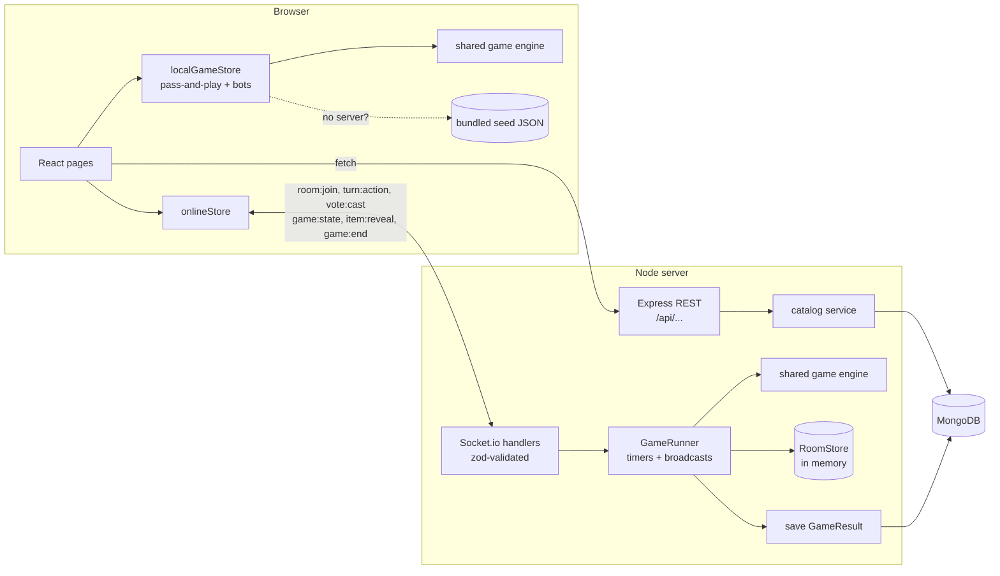

# 💸 Budget Draft

Who can build the better team with **$20**?

Items from a category (footballers, rappers, fast food…) are revealed one at a time.
Players take turns to **BUY** or **PASS**. Only one player gets each item, and you have
to fill every slot without running out of money. The highest-rated team wins, and
everyone votes for the team they like best.

Built with the MERN stack and TypeScript everywhere: React + Vite, Express, MongoDB +
Mongoose and Socket.io.

## Modes

| Mode | How it works | Needs the server? |
| --- | --- | --- |
| 📱 Pass & Play | 2–4 players on one device. A "pass the device" screen between turns. | No (uses bundled data) |
| 🌐 Online Room | Create a room, share the 6-letter code or link. 15s turn timer. | Yes |
| 🤖 Solo vs Bots | You against 1–3 bots that look for good value. | No |

## Setup

You need **Node.js 22.9+** and a **MongoDB** database (local, Docker or Atlas).

```bash
# 1. Install everything (one install for all three packages)
npm install

# 2. Create your .env from the example and fill it in
cp .env.example .env

# 3. (Optional) start MongoDB with Docker
docker compose up -d

# 4. Load the 10 categories (467 items) into MongoDB
npm run seed

# 5. Start the API (port 4000) and the web app (port 5173)
npm run dev
```

Open http://localhost:5173.

Pass-and-play and bot mode work without the server: the app bundles the seed data and
uses it whenever the API can't be reached.

### Environment variables

All variables live in one `.env` file at the repo root. The server checks them with zod
at startup and stops with a clear message if one is missing.

| Variable | Used by | Example | What it's for |
| --- | --- | --- | --- |
| `MONGO_URI` | server | `mongodb://localhost:27017/budget-draft` | Database connection |
| `PORT` | server | `4000` | API + Socket.io port |
| `ADMIN_PASSWORD` | server | at least 8 characters | Password for `/admin` |
| `CLIENT_URL` | server | `http://localhost:5173` | Allowed origin for CORS and sockets |
| `VITE_SERVER_URL` | client | `http://localhost:4000` | Where the web app finds the API |

### Scripts

Run these from the repo root.

| Command | What it does |
| --- | --- |
| `npm run dev` | Server (auto-restarts on change) + client (hot reload) together |
| `npm run seed` | Clears categories and items, then reloads them from `server/seed/*.json` |
| `npm test` | Every Vitest suite (shared, server, client). Includes a typecheck of `shared`. |
| `npm run typecheck` | Strict TypeScript check of all three packages |
| `npm run build` | Production build of the web app into `client/dist` |
| `npm start` | Start the server without file watching |

Tests that need a database start a throwaway in-memory MongoDB, so `npm test` doesn't
need your real database.

## Architecture

```
budget-draft/
├── shared/   Types, zod schemas and the pure game engine. Used by BOTH client and server.
├── server/   Express REST API, Socket.io rooms, Mongoose models, seed data (server/seed/*.json)
└── client/   React + Vite + Tailwind web app, Zustand stores
```



**One game engine, three modes.** All the rules (budget check, turn order, scoring, the
bot) are pure functions in `shared/src/game/`. They take a state and return a new state,
with no network, database or timers. The browser runs them for pass-and-play and bot
games, and the server runs exactly the same code for online rooms.

**The server is in charge online.** For online games the real `GameState` only exists
on the server. Clients send intentions ("BUY", "PASS", a vote), the server checks them
with zod and the engine, then sends everyone the new state. Clients can't skip the
budget rule or act out of turn: the acting player's id comes from their socket, never
from the message.

**The item pool stays secret.** The full state includes `itemPool` (the shuffled items
still to come). Clients only ever get `PublicGameState`, which has
`itemPool?: never` and just an `itemsRemaining` count. Because every server→client
socket event is typed with `PublicGameState`, sending the full state is a compile error.
A type test (`shared/src/__typetests__`) checks that this protection holds.

### REST API

| Method & path | Description |
| --- | --- |
| `GET /api/categories` | All categories with item counts |
| `GET /api/categories/:slug/items` | Items in a category |
| `POST /api/rooms` | Create a room → `{ code }` |
| `GET /api/rooms/:code` | Room info (phase, player count, joinable) |
| `GET /api/leaderboard` | Wins, games played, best score (online games only) |
| `POST /api/results` | Store a finished local/bot game (never ranked) |
| `/api/admin/...` | Category and item CRUD, needs the `x-admin-password` header |

### Socket events

| Client → server | Server → client |
| --- | --- |
| `room:join` (code, name, stored playerId) | `room:update` (lobby + game snapshot) |
| `room:leave` | `item:reveal` (new item + state) |
| `room:settings` (host only) | `game:state` (after every action) |
| `game:start` (host only) | `game:end` (final state + results) |
| `turn:action` (buy/pass + round number) | |
| `vote:cast` | |

Every request gets an acknowledgement: `{ ok: true, data }` or `{ ok: false, error }`.

### Data models

- **Category**: `slug` (unique), `name`, `emoji`, `description`
- **Item**: `name`, `categorySlug`, `price` (1–10), `rating` (1–100), `tag`, optional `emoji`.
  Unique per (category, name).
- **GameResult**: mode, category, settings, players with a *snapshot* of their team and
  scores, `statsWinnerIds`, `voteWinnerIds`, and `countsForLeaderboard` (true only for
  online games).

No images or logos anywhere: items are names and text, shown with an emoji or a
generated initials avatar.
